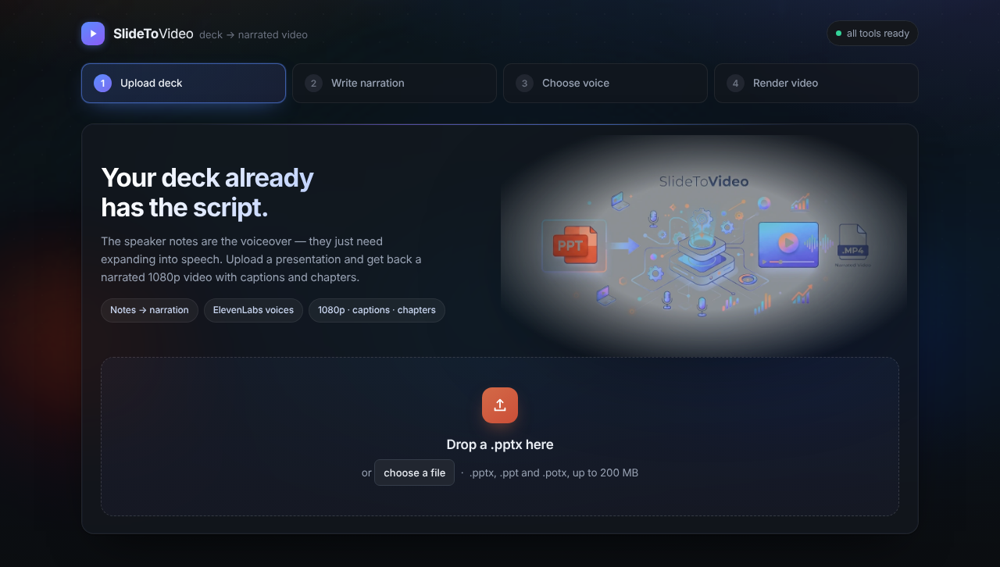
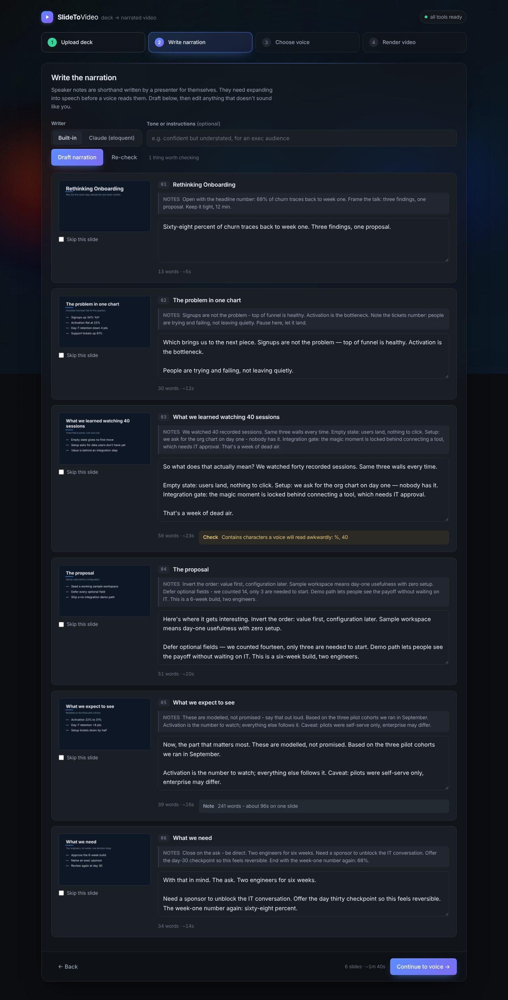
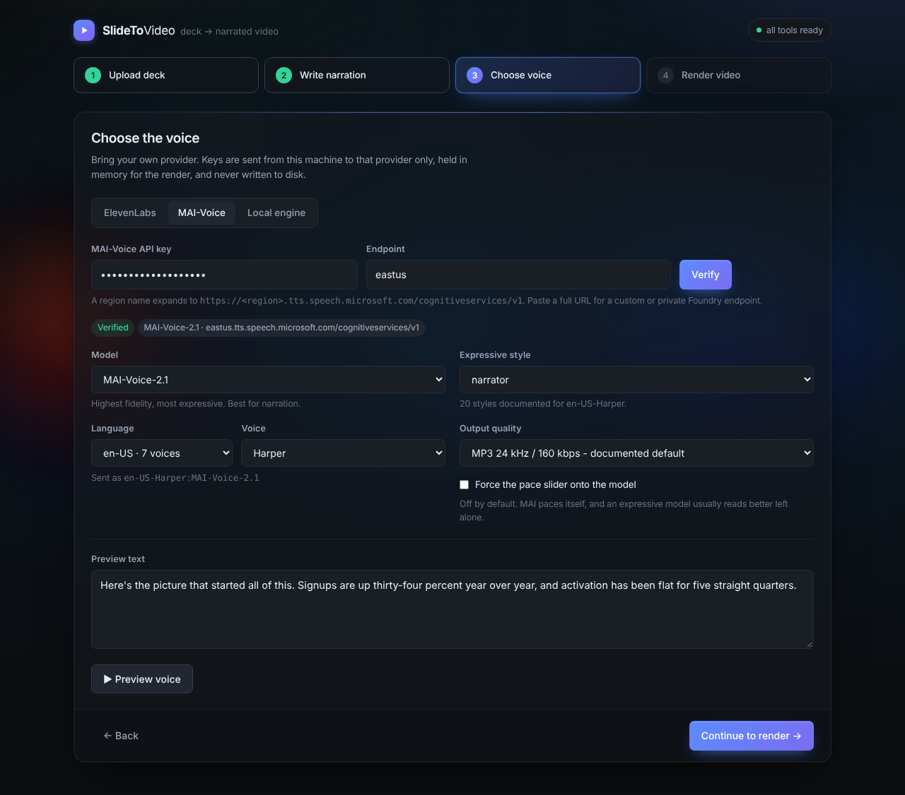

# SlideToVideo

**Turn a PowerPoint into a narrated video. The speaker notes become the voiceover.**

[](https://github.com/5h15h/slidetovideo/actions/workflows/ci.yml)




Speaker notes are shorthand a presenter wrote for themselves. Read aloud
verbatim they sound wrong. SlideToVideo expands them into speech, synthesizes
them with a voice you choose, and cuts a 1080p video where every slide stays on
screen exactly as long as its narration takes.

Everything runs on your own machine. Decks never leave it, and the only network
calls are to whichever voice provider you pick.

- **Notes → narration.** A built-in writer that needs no key, or Claude for a
  genuinely eloquent script. Both leave you an editable draft per slide.
- **An audit that catches what sounds wrong out loud** — digits a voice will
  stumble over, stage directions that leaked into the script, narration that
  just reads the bullets back.
- **Three voice providers.** ElevenLabs, MAI-Voice (Microsoft AI), or a local
  engine. Preview before committing to a full render.
- **Real video.** 1080p H.264, chapter markers per slide, captions as a sidecar
  `.srt` or burned in, subtle slide motion, broadcast-level audio mastering.
- **Installs as a desktop app.** It is a PWA, so Chrome or Edge gives it a dock
  icon and its own window, and it can open `.pptx` files from the OS.

## Quick start

```bash
pip install flask python-pptx pillow numpy requests
# macOS
brew install ffmpeg libreoffice
# Debian/Ubuntu
sudo apt install ffmpeg libreoffice poppler-utils

python3 slidetovideo.py         # starts the renderer and opens the app
```

On macOS double-click **slidetovideo.command**; on Windows,
**slidetovideo.bat**. On Linux, `tools/install-linux-desktop.sh` adds it to the
application menu. `python3 slidetovideo.py --app` skips the browser chrome and
opens a plain window.

## Screenshots

| Write the narration | Choose the voice |
|---|---|
|  |  |

## Install it as a desktop app

It is a PWA, so Chrome or Edge can install it: press **Install app** in the
header, or use the browser's install button in the address bar. You get a dock
or Start-menu icon, its own window with no browser furniture, and a fast start
because the interface is cached locally.

`127.0.0.1` counts as a secure context, so this works with no certificate and
no tunnel.

Two things the installed app can do that a tab cannot:

- **Open `.pptx` files from the OS.** Chrome asks on install whether to let
  SlideToVideo handle presentations. Say yes and "Open with → SlideToVideo"
  drops the deck straight into the uploader.
- **Start instantly and fail clearly.** The interface loads from cache even
  with the renderer stopped, and says so with the command to start it, rather
  than showing a browser error page.

The renderer still has to be running — the work is LibreOffice and ffmpeg on
your own CPU, and no amount of service worker changes that. Launch it from the
dock after starting `slidetovideo.py`, or have the launcher run at login.

### Run it at login

macOS — `~/Library/LaunchAgents/com.slidetovideo.plist`:

```xml
<plist version="1.0"><dict>
  <key>Label</key><string>com.slidetovideo</string>
  <key>ProgramArguments</key>
  <array><string>/usr/bin/python3</string><string>/FULL/PATH/slidetovideo.py</string><string>--no-open</string></array>
  <key>RunAtLoad</key><true/>
</dict></plist>
```
then `launchctl load ~/Library/LaunchAgents/com.slidetovideo.plist`.

Linux — `~/.config/systemd/user/slidetovideo.service`:

```ini
[Unit]
Description=SlideToVideo
[Service]
ExecStart=/usr/bin/python3 /FULL/PATH/slidetovideo.py --no-open
Restart=on-failure
[Install]
WantedBy=default.target
```
then `systemctl --user enable --now slidetovideo`.

Windows — put a shortcut to `slidetovideo.bat` in
`shell:startup`, with the window minimised.

The header shows a green chip when ffmpeg, LibreOffice and pdftoppm are all
found, and names what is missing when they aren't.

## The four steps

**1 · Upload** a `.pptx`, `.ppt` or `.potx`. Slides are rendered to 1920×1080
stills and the speaker notes are read out of the file. Slides with no notes are
skipped by default; hidden slides are excluded.

**2 · Write the narration.** Speaker notes are shorthand a presenter wrote for
themselves — read aloud verbatim they sound wrong. Two drafters:

- **Built-in** (no key, no network). Strips stage directions, expands numbers
  for the mouth, adds connective tissue between slides. Competent; it tidies
  notes for speech rather than writing prose.
- **Claude** (paste an Anthropic API key). Applies the full craft rules and
  actually writes. This is the eloquent option.

Either way you get an editable draft per slide with the original notes beside
it, a word count and a running time estimate. An audit flags the things that
sound wrong out loud: digits or `%` a voice will stumble over, stage directions
that survived into the script, phrases like "as you can see on this slide",
narration that merely recites the bullets.

**3 · Choose the voice.** Three providers, picked with a switch at the top.

- **ElevenLabs.** Paste a key and the app lists the voices on your account with
  your remaining character quota, then exposes model, stability, similarity,
  style exaggeration, speed, speaker boost and output quality.
- **MAI-Voice.** Microsoft AI's speech models, served over Azure Speech. Paste
  a Speech resource key and an endpoint — a region name like `eastus` expands
  to `https://eastus.tts.speech.microsoft.com/cognitiveservices/v1`, or paste a
  full URL for a custom or private Foundry endpoint. Choose MAI-Voice-2.1,
  MAI-Voice-2.1-Flash or the legacy MAI-Voice-2, then a voice from the 97
  across 28 locales. **Verify** does a one-word synthesis so a bad key or
  region fails in a second rather than halfway through a render.
- **Local engine.** `edge-tts`, Azure, Piper, macOS `say`, or the bundled
  `flite`.

Preview any combination on a line of text before committing to a full render.

**4 · Render.** Captions as a sidecar `.srt`, burned in, or off. Slide motion
subtle, stronger or locked. Speaking pace. Accent colour, taken from the deck
unless you override it. Progress reports the cue being synthesized and the
scene being rendered; the result is an MP4 you can play in the page and
download, with a `.srt` beside it.

## How the quality is produced

**Pacing.** Narration is synthesized one sentence at a time and reassembled
with deliberate gaps — 0.34s between sentences, 0.62s between paragraphs, 0.85s
before a slide change, 0.45s after one. Each engine's own padding is trimmed
off first, so those numbers are the only thing setting the rhythm. Audio decides
how long a slide is on screen, never the reverse.

**Continuity.** Because cues are synthesized separately, ElevenLabs is given
`previous_text` and `next_text` for each one, so prosody carries across sentence
boundaries instead of resetting.

**MAI-Voice specifics.** The voice is sent as `<VoiceID>:<ModelSuffix>`, e.g.
`en-US-Harper:MAI-Voice-2.1`. Expressive styles go through
`mstts:express-as`, and they are per-voice — Microsoft documents the list for
only some voices, and an unsupported style is rejected rather than ignored, so
the UI offers a dropdown where the list is known and free text elsewhere.
SSML `prosody` is **off by default**: MAI paces itself, and pushing an
expressive model usually reads worse. Tick "force the pace slider onto the
model" to override.

**Mastering.** Two-pass loudness normalisation to −16 LUFS with a high-pass at
80 Hz, gentle compression and a limiter. Every filter is duration-preserving, so
the timeline stays exact.

**Rendering.** One encoded file per scene with identical settings; crossfades
live inside the scene that begins them, so nothing is encoded twice; scenes are
joined with the concat demuxer and `-c copy` and the audio muxed with
`-c:v copy`. Slides get a ~3.5% Ken Burns drift off a 2× upscale, which stops a
static slide reading as a frozen video without visible stepping.

## Command line

The pipeline underneath the app is scriptable, and a `ppt-to-video` subagent
definition lives in `agent/` for use from Claude Code.

```bash
python3 pipeline/extract.py deck.pptx --out work/
python3 pipeline/synth.py    work/ --tts silent          # pacing dry run
python3 pipeline/synth.py    work/ --tts eleven --voice <voice_id>
python3 pipeline/synth.py    work/ --tts mai    --voice en-US-Harper
python3 pipeline/assemble.py work/ --preview             # frames to eyeball
python3 pipeline/assemble.py work/ --out video.mp4
```

| File | Does |
|---|---|
| `pipeline/extract.py` | notes + 1080p slide stills → `deck.json` |
| `pipeline/narrate.py` | notes → narration, plus the audit |
| `pipeline/tts.py` | backends: eleven, azure, edge, piper, say, flite, silent |
| `pipeline/elevenlabs.py` | ElevenLabs REST client |
| `pipeline/maivoice.py` | MAI-Voice client, voice catalogue, SSML |
| `pipeline/synth.py` | voice + pauses + mastering → `timeline.json`, `captions.srt` |
| `pipeline/assemble.py` | scenes, motion, captions, chapters → `video.mp4` |
| `webapp/server.py` | the local API |

`timeline.json` is the contract between stages.

## Environment variables

| Variable | For |
|---|---|
| `ELEVENLABS_API_KEY` | CLI renders with `--tts eleven` |
| `MAI_VOICE_KEY` / `MAI_VOICE_ENDPOINT` | CLI renders with `--tts mai` |
| `MAI_VOICE_MODEL` / `MAI_VOICE_ID` | MAI defaults |
| `AZURE_SPEECH_KEY` / `AZURE_SPEECH_REGION` | Azure / Foundry backend |
| `PIPER_MODEL` | path to a Piper `.onnx` voice |
| `PPT2VIDEO_JOBS` | where job folders are written (default `./jobs`) |
| `HOST` / `PORT` | server bind, default `127.0.0.1:8808` |

The server binds to localhost. Don't expose it to a network without putting
authentication in front of it — anyone who can reach it can upload decks and
spend your ElevenLabs quota.


## Contributing

CI byte-compiles every module, parses the frontend, runs the pipeline end to
end on a generated sample deck, and builds the renderer image. Run the same
checks locally:

```bash
python -m compileall -q pipeline webapp tools slidetovideo.py
node --check webapp/static/app.js
python examples/make_sample_deck.py
python pipeline/extract.py examples/sample_deck.pptx --out /tmp/w
```

## License

MIT — see [LICENSE](LICENSE).
